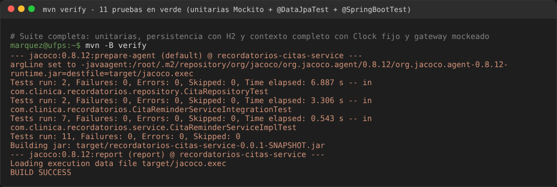
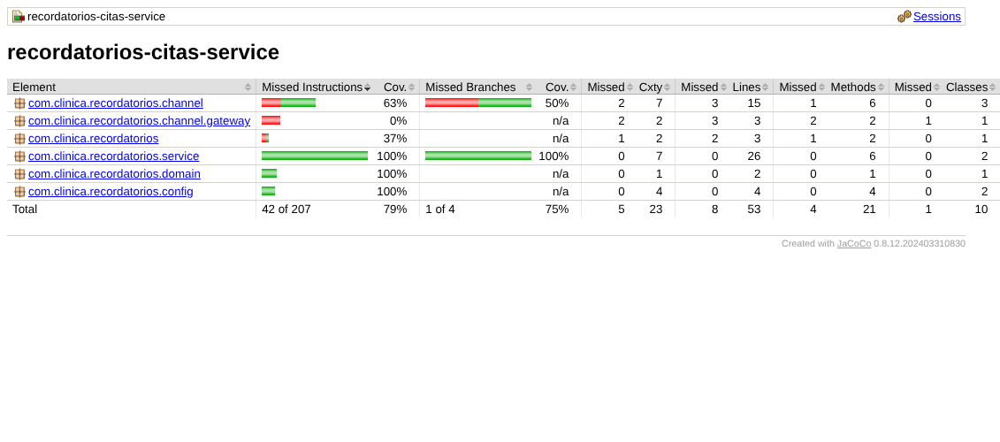
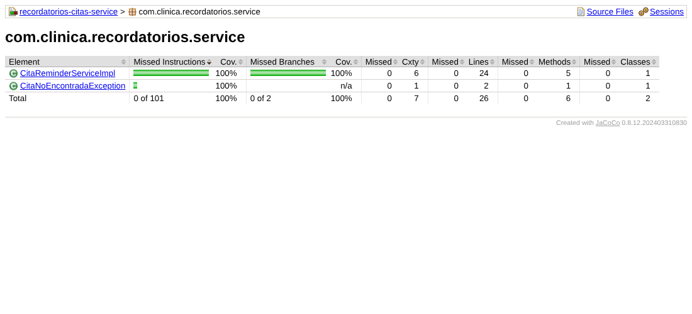

# Recordatorios Citas Service


**Universidad Francisco de Paula Santander — Ingeniería de Sistemas**
**Curso:** Patrones de Diseño de Software (1156701-A) — Post-contenido Unidad 9
**Estudiante:** Diego Armando Márquez Rigaud — **Código:** 1152115

## Descripción

Repositorio del post-contenido de la Unidad 9 de Patrones de Diseño de Software. Un único proyecto
Spring Boot (Java 21) que envía recordatorios de citas por el canal preferido del paciente (correo o SMS),
construido desde el inicio con **Strategy** (`ReminderChannel`) y **Factory Method**
(`ReminderChannelFactory`) inyectados por constructor. La Parte 1 prueba el servicio con JUnit 5 y
Mockito eligiendo de forma justificada el Test Double de cada colaborador; la Parte 2 refactoriza una
funcionalidad que violaba DIP, agrega pruebas de integración con H2 y configura GitHub Actions.

```
src/main/java/com/clinica/recordatorios/
├── domain/        Cita (entidad JPA), CanalNotificacion
├── repository/    CitaRepository (JpaRepository + consulta derivada por ventana de fechas)
├── channel/       ReminderChannel (Strategy), EmailReminderChannel, SmsReminderChannel,
│   │              ReminderChannelFactory (Factory Method) y su implementación
│   └── gateway/   NotificadorSmsGateway, TwilioNotificadorSmsGateway (simulado)
├── service/       CitaReminderService, CitaReminderServiceImpl, CitaNoEncontradaException
└── config/        ClockConfig y CanalUrgenteConfig (composition root: el único lugar con "new")
src/test/java/com/clinica/recordatorios/
├── service/CitaReminderServiceImplTest.java      7 pruebas unitarias (Mockito + Clock.fixed)
├── repository/CitaRepositoryTest.java            2 pruebas @DataJpaTest (H2)
└── CitaReminderServiceIntegrationTest.java       2 pruebas @SpringBootTest (H2 real + @MockBean del gateway)
.github/workflows/ci.yml                          mvn -B verify en cada push/PR a main + artefacto JaCoCo
```

## Parte 1 — Pruebas Unitarias con JUnit 5 y Mockito

`CitaReminderServiceImplTest` aísla `CitaReminderServiceImpl` de sus colaboradores y verifica: uso del
canal preferido, límites exactos de la ventana de 24 horas gracias al reloj fijo, que sin citas no se
consulta la Factory, y que con canales mixtos cada cita usa su estrategia y se marca **después** de enviar
(`InOrder`). Los nombres siguen la convención `metodoBajoPrueba_condicion_resultado`.

## Parte 2 — Refactor DIP, Integración y CI/CD

`enviarRecordatorioUrgente` nació con un `new` hardcodeado que lo hacía imposible de testear; el refactor
movió esa construcción a `config/CanalUrgenteConfig.java` e inyectó la abstracción por constructor con
`@Qualifier("canalUrgente")`. `CitaRepositoryTest` (`@DataJpaTest`) y
`CitaReminderServiceIntegrationTest` (`@SpringBootTest`) prueban la persistencia y el flujo completo con
H2 y un `Clock` fijo. El pipeline `.github/workflows/ci.yml` ejecuta `mvn verify` en cada push y publica
el reporte de cobertura como artefacto.

## Decisiones de diseño

### Mock vs. Stub vs. Fake (Parte 1)

| Colaborador | Elección | Justificación (tabla de Test Doubles, Sección 3.1) |
|---|---|---|
| `CitaRepository` | **Mock** | No basta con stubbear `findBy...` para que devuelva una lista: la prueba también debe **verificar** que `save()` se invoca exactamente una vez con la cita marcada como enviada (y nunca cuando no hay citas o cuando falla el envío). Controlar la respuesta y verificar la interacción a la vez es un Mock, no un Stub. |
| `ReminderChannelFactory` / `ReminderChannel` | **Mock** | El comportamiento bajo prueba es la **selección de estrategia**: que el servicio pida `EMAIL` cuando la cita lo prefiere y que ese canal reciba el mensaje. Eso solo se comprueba verificando interacciones (`verify(factory).obtenerCanal(EMAIL)`, `verify(canal).enviar(...)`), no con un valor de retorno. |
| `Clock` | **Fake** (`Clock.fixed`) | Existe una implementación real y completa en la librería estándar que se comporta igual que en producción con el instante congelado. Mockear `Clock` exigiría stubbear `instant()` y `getZone()` por separado y arriesgarse a que `LocalDateTime.now(clock)` no funcione como un reloj real. Con el fake, la prueba de la ventana afirma valores exactos (`2026-08-10T09:00` a `2026-08-11T09:00`) en cualquier máquina y a cualquier hora. |

### Por qué Strategy facilitó las pruebas

Sin `ReminderChannel` como interfaz, la lógica de envío (SMTP o SMS) estaría escrita en línea dentro del
servicio y probar la selección de canal exigiría mockear librerías de bajo nivel (cliente SMTP, cliente
HTTP del proveedor) o capturar la salida estándar. Con Strategy, un único `@Mock ReminderChannel` sirve
para cualquier canal y la prueba se expresa en el vocabulario del dominio: "se envió por este canal".

### Por qué Factory Method facilitó las pruebas

Sin `ReminderChannelFactory`, el servicio tendría un `switch` embebido y la decisión del canal solo sería
observable indirectamente (viendo qué se imprimió o qué se envió). Con la Factory inyectada, la selección
es una interacción explícita y verificable —`verify(reminderChannelFactory).obtenerCanal(EMAIL)`— y la
prueba de canales mixtos puede devolver un mock distinto por tipo de canal.

### Diagnóstico antes del refactor (Parte 2)

En su primera versión (commit `feat(service): agregar enviarRecordatorioUrgente con new hardcodeado`), la
línea responsable era:

```java
ReminderChannel canalUrgente = new SmsReminderChannel(new TwilioNotificadorSmsGateway());
```

Como el canal y el gateway se construían **dentro del cuerpo del método**, una prueba no tenía ningún
punto donde insertar un Test Double: cada ejecución creaba un `TwilioNotificadorSmsGateway` real, así que
era imposible simular que el proveedor de SMS falla y comprobar que la cita **no** queda marcada como
enviada. En contraste, `enviarRecordatoriosPendientes()` ya era testeable desde la Parte 1 porque sus tres
colaboradores llegan por constructor. Se podía forzar con `Mockito.mockConstruction()`, pero eso habría
tapado un problema de diseño con una herramienta de pruebas.

### El refactor DIP: antes y después

| | Antes (Paso 7) | Después (Paso 8) |
|---|---|---|
| Construcción del canal | `new SmsReminderChannel(new TwilioNotificadorSmsGateway())` dentro del método | `@Bean canalUrgente(NotificadorSmsGateway)` en `CanalUrgenteConfig` |
| Dependencia del servicio | Clases concretas | Abstracción `ReminderChannel` por constructor (`@Qualifier("canalUrgente")`) |
| ¿Testeable con Mockito? | No: no hay punto de sustitución | Sí: `@Mock ReminderChannel canalUrgenteMock` |

El comportamiento externo no cambió. La prueba `enviarRecordatorioUrgente_gatewayFalla_noMarcaComoEnviado`
(con `doThrow(...).when(canalUrgenteMock)`) solo pudo escribirse después del refactor: es la evidencia de
que la testabilidad es consecuencia directa de aplicar DIP. `CitaReminderServiceIntegrationTest` comprueba
además que el bean real del composition root usa el gateway de SMS.

### H2 real pero gateway mockeado

En `CitaReminderServiceIntegrationTest` conviven una base de datos real (H2 en memoria) y un `@MockBean`
sobre `NotificadorSmsGateway`. H2 es un fake aceptable porque su contrato SQL/JPA es equivalente al de la
base real y no requiere infraestructura; un proveedor de SMS de terceros no tiene un equivalente gratuito y
determinista, y usarlo de verdad haría depender cada ejecución de credenciales, red y disponibilidad. Se
corrigió un detalle del enunciado: el `@Bean` de prueba se llama `clockFijo()` y no `clock()`, porque
repetir el nombre del bean de `ClockConfig` produce `BeanDefinitionOverrideException`; `@Primary` hace que
sea el reloj inyectado.

### Sin contenedor de base de datos en CI

El workflow no declara `services:` (PostgreSQL, por ejemplo) porque todas las pruebas de integración usan
H2 en memoria. Con Testcontainers el runner necesitaría Docker y tardaría más en arrancar; la elección de H2
simplifica directamente el pipeline.

## Evidencia

**Pruebas en verde (`mvn verify`)**


**Reporte de cobertura JaCoCo (`target/site/jacoco/index.html`)** — el paquete `service` tiene 100 % de
instrucciones y ramas; los porcentajes bajos corresponden a los `System.out` simulados del canal de correo y
del gateway, y al `main` de la aplicación.



El estado del pipeline se ve en el badge de la parte superior y en la pestaña **Actions** del repositorio.

## Ejecutar las pruebas

```bash
mvn test       # pruebas (unitarias + integración, todas con H2 en memoria)
mvn verify     # pruebas + reporte de cobertura en target/site/jacoco/index.html
mvn spring-boot:run
```

## Herramientas utilizadas

- Java 21, Spring Boot 3.3, Spring Data JPA, H2, Lombok
- JUnit 5, Mockito, Spring Boot Test (`@DataJpaTest`, `@SpringBootTest`, `@MockBean`), JaCoCo
- Apache Maven, GitHub Actions, Git, GitHub

## Conclusiones

Los patrones de las unidades anteriores no solo organizaron el código: definieron sus puntos de prueba.
Strategy permitió verificar cualquier canal con un solo mock y Factory Method convirtió la elección del
canal en una interacción observable. Elegir el Test Double por lo que la prueba necesita (verificar
interacciones vs. comportamiento real) llevó a mockear el repositorio y la factory pero a usar
`Clock.fixed` como fake. El caso del canal urgente mostró que cuando algo "no se puede probar" el problema
suele ser el diseño: mover el `new` al composition root bastó para escribir la prueba del fallo del
gateway. H2 en memoria permitió pruebas de integración reales y un pipeline de CI sin contenedores.
